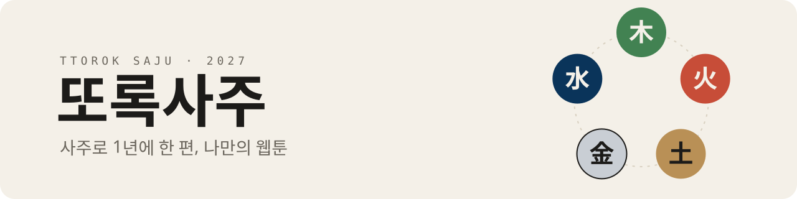

<picture>
  <source media="(prefers-color-scheme: dark)" srcset="assets/banner-dark.svg">
  
</picture>

 

### 또록사주는

**내 사주로 1년에 한 편씩 만들어지는 웹툰**입니다.

- **주인공은 나**: 혼자 보는 개인 웹툰, 연인과 함께 주인공이 되는 커플 웹툰
- **또록이가 변신해요**: 마스코트 또록이가 내 일간(日干)의 모습으로 변신해 이야기를 연기합니다
- **채팅으로 읽는 웹툰**: 장면마다 오가는 대화와, 그해의 흐름을 담은 간지 카드
- **올해부터, 앞으로의 이야기**: 지나간 날이 아니라 오늘 이후의 한 해를 그립니다

> 사주를 바탕으로 지어낸 이야기입니다. 재미로 봐 주세요.

### 열 가지 또록이

| 甲 | 乙 | 丙 | 丁 | 戊 | 己 | 庚 | 辛 | 壬 | 癸 |
|:-:|:-:|:-:|:-:|:-:|:-:|:-:|:-:|:-:|:-:|
| 큰 나무 | 덩굴·꽃 | 태양 | 촛불 | 산 | 밭·흙 | 바위·쇠 | 보석 | 바다 | 빗방울 |

### 오픈

**2027년 입춘(2월 4일)** 오픈을 준비하고 있습니다.

### Built with

